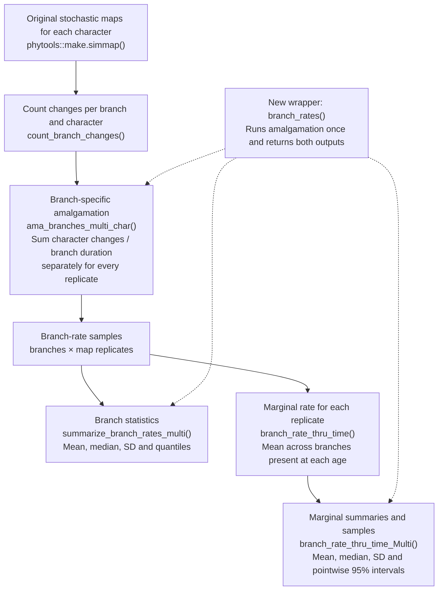

# Ontology-Informed Phylogenetic Comparative Analyses # 

-   Authors: Diego Porto and Sergei Tarasov
-   Maintainer: Diego Porto

This is the alpha version of the package. Please, feel free to try it out, but be aware that the documentations is still incomplete and some functions may have issues! But overall, everything seens to be working well so far...

-   Install package:
```
install.packages("remotes")
require(remotes)
remotes::install_github("diegosasso/ontophylo")
```


-   Please report any bugs or issues at:
https://github.com/diegosasso/ontophylo/issues


-   Tutorial and examples:
https://github.com/diegosasso/ontophylo/XXXXX


-   Manuscript describing package:
https://doi.org/XX.XXXX/XXX/XXX

## Branch-specific amalgamation and rates

`branch_rates()` integrates the branch-specific functions developed by Sergei
Tarasov for the Hymenoptera analyses. For each map replicate and branch, it sums
mapped change counts across the selected characters and divides by branch
duration. Use the original individual-character maps; this workflow does not
require discretization, a stacked-state map, or NHPP estimation.



The diagram shows the public functions for each step. Internally, the wrapper
summarizes the already calculated rate samples instead of repeating amalgamation.
The original function names are retained. `get_branch_rate_sample_smaps()` and
`summarize_branch_rates()` also support a single character.

```r
library(ontophylo)

tree <- ape::read.tree(text = "((a:1,b:1):1,c:2);")
Q <- matrix(c(-0.5, 0.5, 0.5, -0.5), nrow = 2)
dimnames(Q) <- list(c("0", "1"), c("0", "1"))
character1 <- c(a = "0", b = "1", c = "0")
character2 <- c(a = "1", b = "0", c = "1")

set.seed(191119)
maps1 <- phytools::make.simmap(tree, character1, Q = Q, pi = c(0.5, 0.5),
                              nsim = 20, message = FALSE)
maps2 <- phytools::make.simmap(tree, character2, Q = Q, pi = c(0.5, 0.5),
                              nsim = 20, message = FALSE)
characters <- list(char1 = maps1, char2 = maps2)

result <- branch_rates(characters, time_points = seq(2, 0, by = 0.1),
                        time_scale = "age")
result$rate_samples       # branches × maps
result$branch_summary     # edge, parent, child, length, mean, median, SD, bounds
result$marginal_samples   # ages × maps; ages are in marginal_summary$time
result$marginal_summary   # age, number of branches, mean, median, SD, bounds

# The same analysis using the original functions explicitly:
samples <- ama_branches_multi_char(characters)
branch_means <- summarize_branch_rates_multi(characters, stat = "mean")
branch_bounds <- summarize_branch_rates_multi(characters, stat = "quantile",
                                              probs = c(0.025, 0.975))
marginal <- branch_rate_thru_time_Multi(tree, samples, n_points = 100,
                                        return_samples = TRUE)
```

For an anatomical group, select its unique character IDs before calling the
wrapper, for example `branch_rates(characters[query$head])` when `query` is a
result from `RAC_query()` and those characters occur in `characters`. Analyze
overlapping groups separately; summing their outputs would count shared
characters more than once.

Inputs must have matching trees, tip labels, edge order, branch lengths and map
sample sizes. Rates have units of total character changes per tree time unit;
divide by the number of included characters for a mean per character. The
functions retain the original pairing of map replicates across characters.

Marginal rates are calculated for each replicate and then summarized, preserving
dependence among its branch rates. The 95% bounds are pointwise quantiles across
reconstructed histories, conditional on the supplied tree, Q and observations.
They do not by themselves include parameter uncertainty or correct incomplete
taxon sampling. The method summarizes mapped changes; it does not fit separate Q
matrices to branches.

Marginal reconstruction requires a rooted ultrametric tree. Set
`marginal = FALSE` for branch-only results. `time_scale = "age"` accepts times
before the present; the default `"root"` retains the original elapsed-from-root
input convention. Returned `time` always means age before the present. At an
internal node, descendant branches contribute; at the present, terminal branches
contribute. Branch lengths must be positive.

